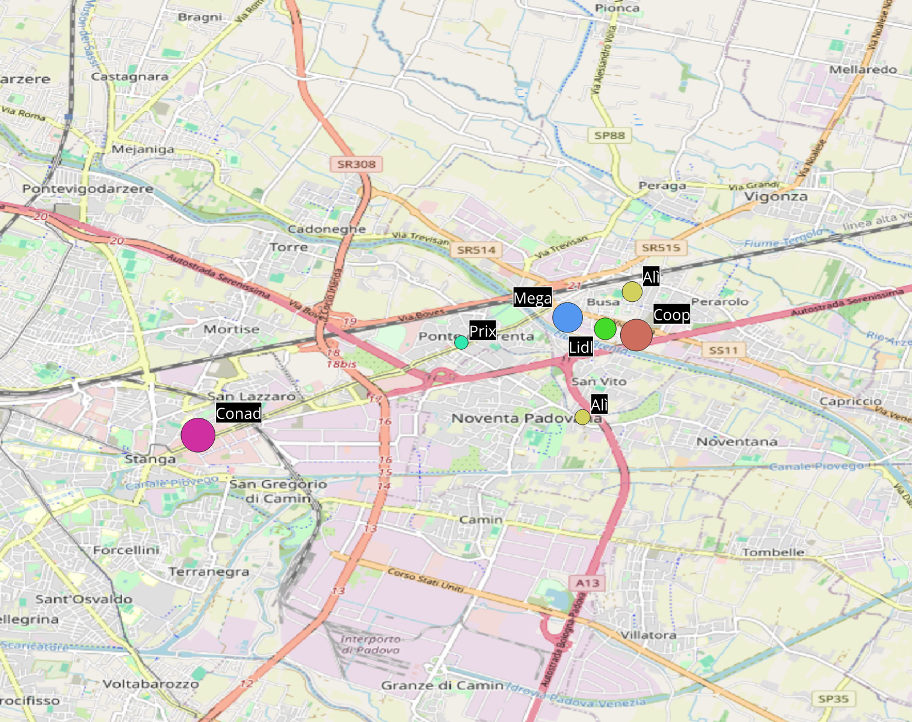
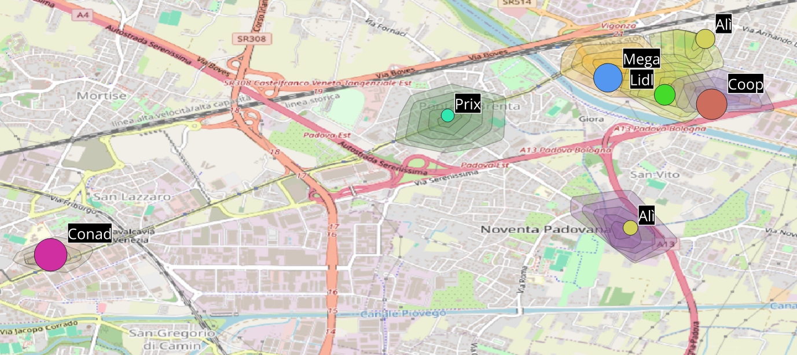
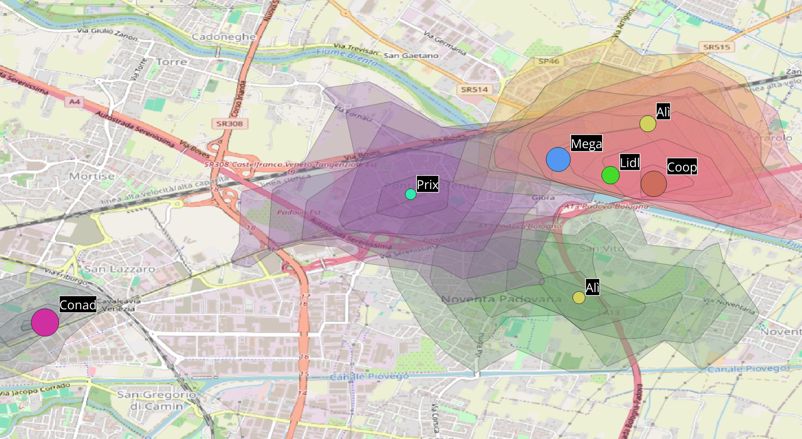
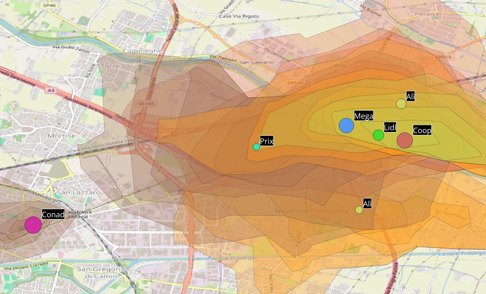

# Analisi di localizzazione retail - Padova Est

Analisi in QGIS per capire se lungo via San Marco, nella zona est di Padova,
c'è spazio per un nuovo punto vendita alimentare della GDO.

## Domanda
Lungo via San Marco esiste una zona poco servita dai supermercati?
E se sì, quale formato di punto vendita avrebbe senso per servirla?

## 1. Mappatura dei concorrenti e scelta dell'area di studio

Ho estratto da OpenStreetMap, con Overpass Turbo (overpass-turbo.eu), tutti i supermercati,
i discount e i negozi alimentari di prossimità entro 10 km dal centro di Padova:

    [out:csv(::lat, ::lon, name, brand, shop; true; ",")][timeout:30];
    (
      node["shop"="supermarket"](around:10000, 45.4064, 11.8767);
      way["shop"="supermarket"](around:10000, 45.4064, 11.8767);
      relation["shop"="supermarket"](around:10000, 45.4064, 11.8767);
      node["shop"="convenience"](around:10000, 45.4064, 11.8767);
      way["shop"="convenience"](around:10000, 45.4064, 11.8767);
    );
    out center;

Ho importato il CSV in QGIS e tenuto solo supermercati e discount della GDO,
escludendo i piccoli negozi di prossimità.

Analizzare tutta Padova nel dettaglio sarebbe stato troppo ampio: dopo una prima lettura
della mappa dei concorrenti, ho ristretto l'analisi alla zona est, lungo via San Marco,
dove la distribuzione dei punti vendita mostrava un possibile vuoto:
- a ovest, alla Stanga, un grande Conad dentro un centro commerciale;
- a est, vicino a Busa, un polo con tre grandi punti vendita (Mega, Coop, Lidl) e un Alì;
- in mezzo, a Ponte di Brenta, solo un Prix di piccole dimensioni.

La dimensione dei cerchi indica la dimensione del punto vendita, stimata misurando
manualmente l'area degli edifici su Google Earth (è l'ingombro dell'edificio,
non la superficie di vendita).

Il tratto centrale è occupato soprattutto dalla zona industriale e da uffici:
un'area con pochi residenti, ma con molte persone che ci lavorano ogni giorno.

  

## 2. Isocrone di copertura dei concorrenti

Per capire quale zona è già servita, ho calcolato per ogni punto vendita le isocrone
a 5 minuti a piedi, in bici e in auto con OpenRouteService (openrouteservice.org),
e le ho importate in QGIS. Le fasce interne indicano intervalli di 1 minuto, da 1 a 5 minuti.

**A piedi:** ogni punto vendita copre solo l'area immediatamente vicina.
Il tratto di via San Marco tra Conad (Stanga) e Prix (Ponte di Brenta) resta scoperto.

  

**In bici:** l'area di Prix si estende verso ovest fino allo svincolo di Padova Est,
ma la fascia verso San Lazzaro e la zona industriale resta in gran parte scoperta.

  

**In auto:** le aree dei punti vendita si sovrappongono molto attorno al polo di Busa,
ma la zona industriale a sud di via San Marco resta in gran parte fuori dalle isocrone
a 5 minuti: anche in auto, è il vuoto più evidente dell'area.

  

**Lettura:** la zona industriale non è servita da nessun punto vendita entro 5 minuti,
né a piedi né in auto. Chi ci lavora oggi deve raggiungere i grandi poli di Busa o della Stanga.

## 3. Ipotesi di formato: un discount rapido per chi lavora nella zona

Da qui nasce l'ipotesi di un discount di fronte alla zona industriale, su via San Marco,
pensato per chi ci lavora: all'arrivo, all'uscita o in pausa pranzo.

Il vantaggio rispetto ai grandi poli vicini sarebbe la rapidità:
- tempo di accesso stimato di 3 - 4 minuti in auto, contro i 7 - 8 per raggiungere i poli esistenti;
- prodotti freschi e take away pronto;
- ampio parcheggio, con entrata e uscita veloci;
- niente file lunghe, a differenza dei grandi centri.

## Limiti
- I dati OpenStreetMap possono essere incompleti o non aggiornati.
- Le dimensioni dei punti vendita sono stime dell'area degli edifici misurata su Google Earth,
  non la superficie di vendita reale.
- Le isocrone considerano i tempi di percorrenza teorici, non traffico e parcheggi.
- I tempi di accesso del nuovo punto vendita sono stime, da verificare con un'isocrona dal sito ipotizzato.
- Non sono considerati affitti, disponibilità di immobili e vincoli urbanistici.

## Strumenti
QGIS, OpenRouteService (isocrone), Overpass Turbo (dati OpenStreetMap), Google Earth, dati ISTAT
