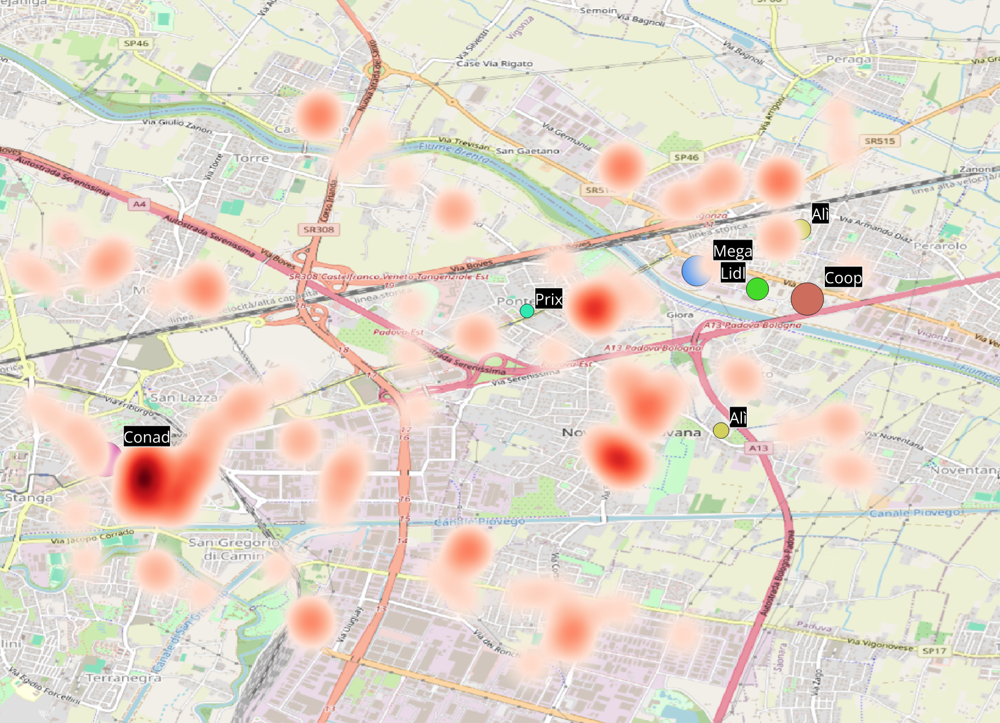
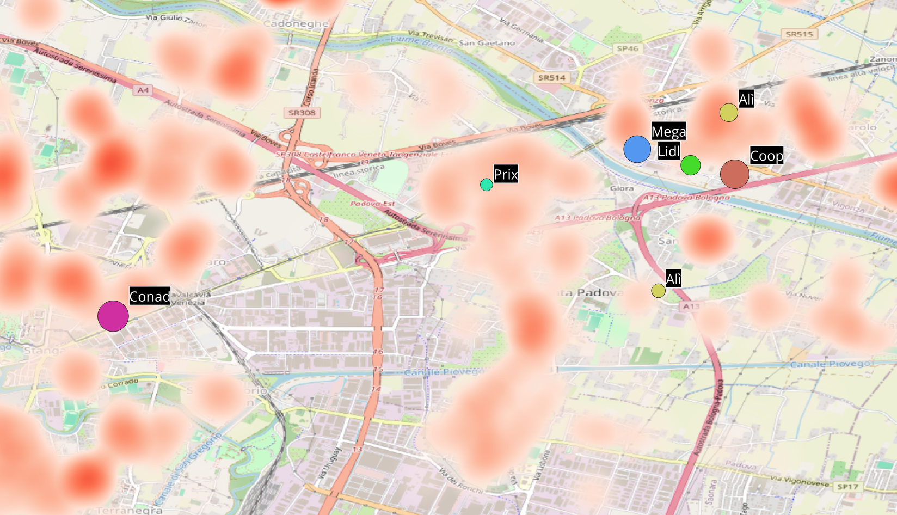
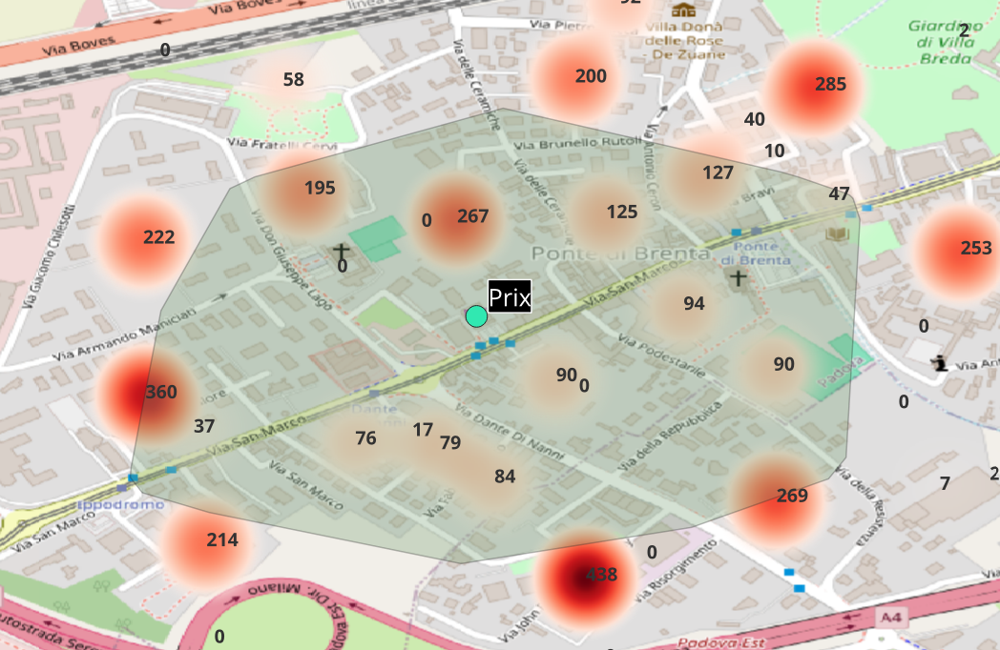
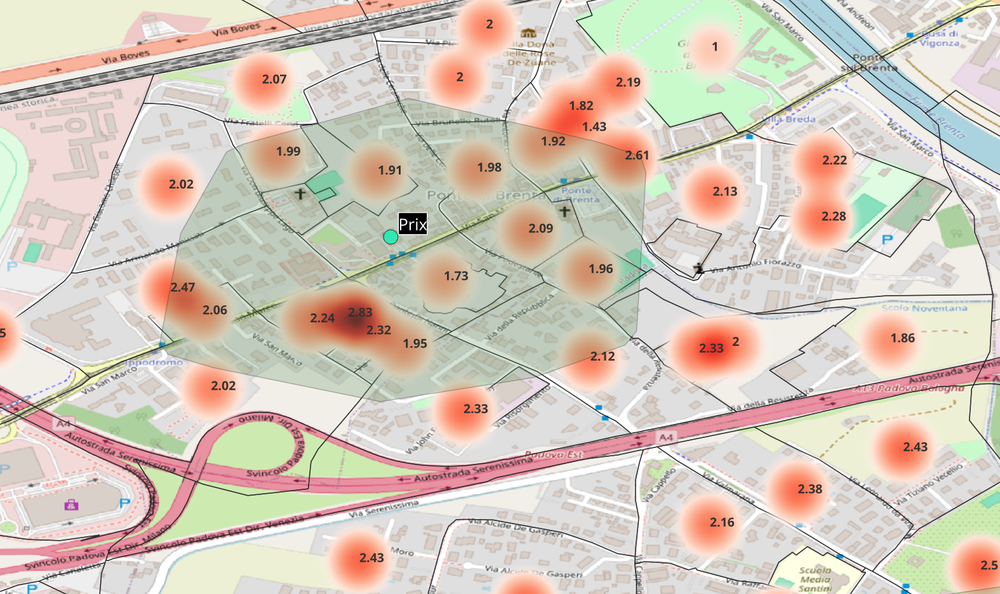
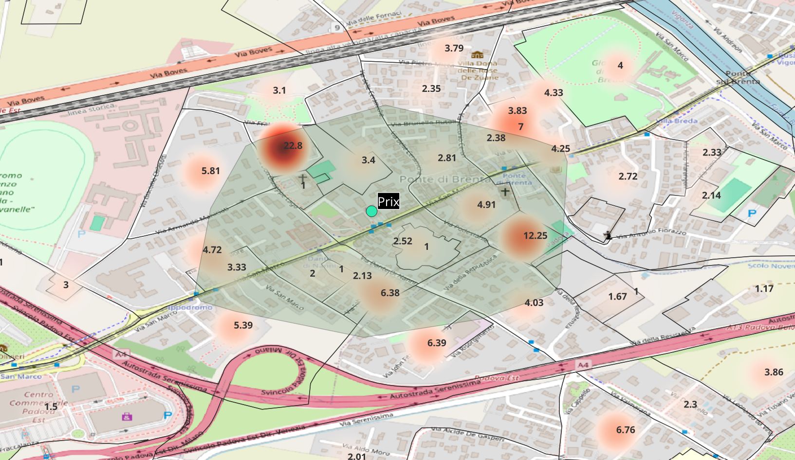
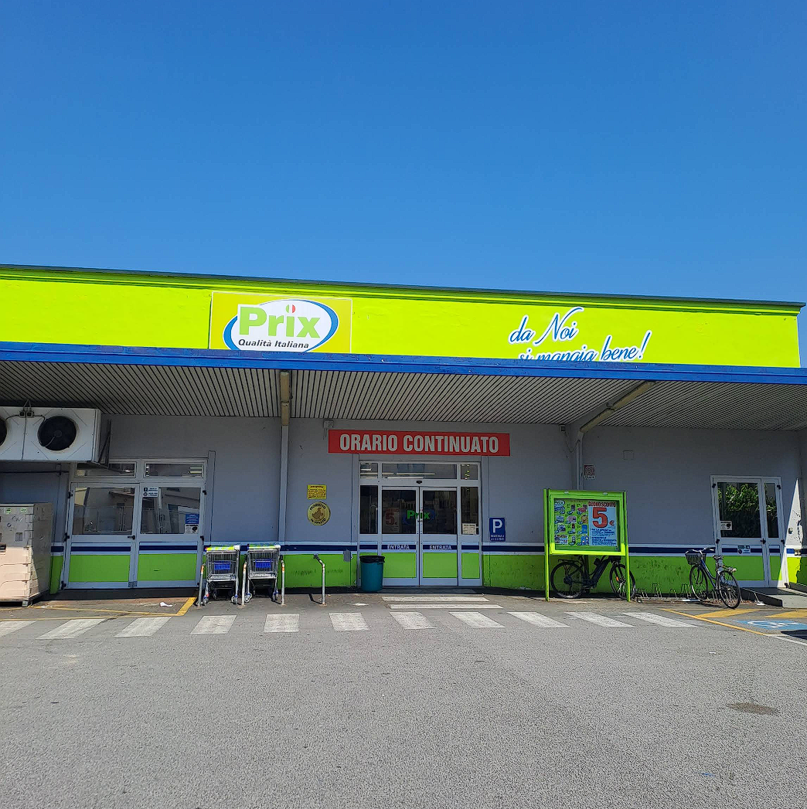

# Analisi di localizzazione retail - Padova Est

Analisi in QGIS per capire se lungo via San Marco, nella zona est di Padova,
c'è spazio per un nuovo punto vendita alimentare della GDO.

## Domanda
Lungo via San Marco esiste una zona poco servita dai supermercati?
E se sì, quale formato di punto vendita avrebbe senso per servirla?

## 1. Mappatura dei concorrenti e scelta dell'area di studio

Ho estratto da OpenStreetMap, con Overpass Turbo (overpass-turbo.eu), tutti i supermercati,
i discount e i negozi alimentari di prossimità entro 10 km dal centro di Padova:

    [out:csv(::lat, ::lon, name, brand, shop; true; ",")][timeout:30];
    (
      node["shop"="supermarket"](around:10000, 45.4064, 11.8767);
      way["shop"="supermarket"](around:10000, 45.4064, 11.8767);
      relation["shop"="supermarket"](around:10000, 45.4064, 11.8767);
      node["shop"="convenience"](around:10000, 45.4064, 11.8767);
      way["shop"="convenience"](around:10000, 45.4064, 11.8767);
    );
    out center;

Ho importato il CSV in QGIS e tenuto solo supermercati e discount della GDO,
escludendo i piccoli negozi di prossimità.

Analizzare tutta Padova nel dettaglio sarebbe stato troppo ampio: dopo una prima lettura
della mappa dei concorrenti, ho ristretto l'analisi alla zona est, lungo via San Marco,
dove la distribuzione dei punti vendita mostrava un possibile vuoto:
- a ovest, alla Stanga, un grande Conad dentro un centro commerciale;
- a est, vicino a Busa, un polo con tre grandi punti vendita (Mega, Coop, Lidl) e un Alì;
- in mezzo, a Ponte di Brenta, solo un Prix di piccole dimensioni.

La dimensione dei cerchi indica la dimensione del punto vendita, stimata misurando
manualmente l'area degli edifici su Google Earth (è l'ingombro dell'edificio,
non la superficie di vendita).

Il tratto centrale è occupato soprattutto dalla zona industriale e da uffici:
un'area con pochi residenti, ma presumibilmente frequentata ogni giorno da chi ci lavora.

  

## 2. Isocrone di copertura dei concorrenti

Per capire quale zona è già servita, ho calcolato per ogni punto vendita le isocrone
a 5 minuti a piedi, in bici e in auto con OpenRouteService (openrouteservice.org),
e le ho importate in QGIS. Le fasce interne indicano intervalli di 1 minuto, da 1 a 5 minuti.

**A piedi:** ogni punto vendita copre solo l'area immediatamente vicina.
Il tratto di via San Marco tra Conad (Stanga) e Prix (Ponte di Brenta) resta scoperto.

  

**In bici:** l'area di Prix si estende verso ovest fino allo svincolo di Padova Est,
ma la fascia verso San Lazzaro e la zona industriale resta in gran parte scoperta.

  

**In auto:** le aree dei punti vendita si sovrappongono molto attorno al polo di Busa,
ma la zona industriale a sud di via San Marco resta in gran parte fuori dalle isocrone
a 5 minuti: anche in auto, è il vuoto più evidente dell'area.

  

**Lettura:** la zona industriale non è servita da nessun punto vendita entro 5 minuti,
né a piedi né in auto. Chi ci lavora oggi deve raggiungere i grandi poli di Busa o della Stanga.

## 3. Attrattori: dove si concentrano le persone durante il giorno

Per capire dove si concentra la domanda durante il giorno, ho mappato gli attrattori
della zona: uffici, aziende, scuole, palestre, servizi, estratti da OpenStreetMap
con Overpass Turbo, e ne ho calcolato la densità con una mappa di calore in QGIS.

  

La concentrazione più alta di attrattori è alla Stanga, già servita dal Conad,
seguita da Ponte di Brenta e Noventa Padovana.
Nella zona industriale a sud di via San Marco gli attrattori mappati sono pochi e sparsi.

Questo però non significa che lì ci siano poche persone durante il giorno:
OpenStreetMap registra bene negozi e servizi, ma molto meno aziende e capannoni.
La mappa quindi probabilmente sottostima chi lavora nella zona industriale.

Per misurare questa domanda servirebbero i dati ISTAT sugli addetti delle imprese
per sezione di censimento e, se disponibili, dati sui flussi di persone.
I dati ISTAT sul pendolarismo misurano invece gli spostamenti tra Comuni
e non permettono di isolare la zona industriale.

## 4. Residenti

Per stimare la domanda residenziale ho usato i dati ISTAT sulla popolazione residente per sezione di censimento (censimento 2021), rappresentati con una mappa di calore
pesata sul numero di residenti.

  

La zona industriale tra la Stanga e Ponte di Brenta è quasi priva di residenti.
I residenti si concentrano a ovest (Stanga, San Lazzaro, Mortise), attorno a Ponte di Brenta,
nella fascia tra Ponte di Brenta e Camin e verso Noventa Padovana.

Un punto vendita nel tratto centrale di via San Marco dipenderebbe quindi quasi solo
da chi lavora nella zona industriale e da chi ci transita.
Spostandolo verso est, tra Ponte di Brenta e Camin, potrebbe servire sia i lavoratori
della zona industriale sia i residenti vicini: un'ipotesi da verificare
con un'isocrona calcolata dal sito ipotizzato.

## 5. Caso studio: il bacino pedonale di Prix

Per testare il metodo su un punto vendita esistente, ho incrociato l'isocrona
a 5 minuti a piedi del Prix di Ponte di Brenta con i dati ISTAT per sezione di censimento.

  

Nel bacino a 5 minuti a piedi risiedono circa **1.688 persone**, calcolate in QGIS
intersecando le sezioni di censimento ISTAT con l'isocrona.
I residenti sono distribuiti soprattutto ai margini dell'isocrona.

  

Le famiglie sono piccole, con circa 2 componenti in media.

  

La maggior parte delle sezioni ha edifici piccoli, con 2–5 appartamenti in media.
Fanno eccezione alcuni condomini più grandi: una sezione a nord-ovest di Prix
arriva a circa 23 appartamenti per edificio, e una a est a circa 12.
La zona è quindi residenziale a bassa densità, con pochi edifici più grandi
che concentrano una parte dei residenti.

**Lettura:** non tutti questi residenti fanno la spesa abitualmente da Prix:
molti probabilmente raggiungono in auto i supermercati più grandi della zona.
Il numero di residenti nel bacino è quindi un tetto massimo, non la clientela reale:
per stimarla servirebbe uno studio più dettagliato, ad esempio sulle abitudini di spesa.

**Confronto tra punti vendita:** incrociando le isocrone con i dati ISTAT,
Prix è il punto vendita che intercetta più residenti entro 5 minuti,
sia a piedi sia in bici sia in auto.

**Perché:** Prix si trova al centro di un'ampia zona residenziale delimitata
da barriere naturali e infrastrutturali (il fiume Brenta, le autostrade, la ferrovia).
Queste barriere definiscono il suo bacino e lo separano dai grandi poli della zona,
che sono più facili da raggiungere in auto che a piedi o in bici.

**Cosa ne ricavo:**
- La mia ipotesi è che, tra i punti vendita della zona, Prix sia quello con il fatturato più alto
  in rapporto alle sue dimensioni. Intercetta più residenti di tutti, ha un bacino protetto
  dalle barriere e appartiene a un'insegna con risultati solidi: secondo Mediobanca,
  Prix Quality è tra i distributori più redditizi della GDO italiana (ROI medio del 16% nel 2019–2024),
  e secondo Nomisma la sua quota nel mercato discount è passata dallo 0,8% al 2,3% in cinque anni.
  Senza dati di vendita del singolo punto vendita resta però un'ipotesi, non una misura.
- Il punto vendita è datato: ha una posizione molto forte ma un format poco moderno,
  un possibile punto debole se un concorrente aprisse un negozio più nuovo nelle vicinanze.

  

- Il bacino di Prix non raggiunge la zona industriale, che resta scoperta.

## 6. Ipotesi di formato: un discount rapido per chi lavora nella zona

L'analisi mostra che il vuoto lungo via San Marco riguarda soprattutto la zona industriale:
pochi residenti, nessun punto vendita entro 5 minuti, e una domanda legata
a chi ci lavora più che a chi ci abita.

Da qui l'ipotesi di un discount di fronte alla zona industriale, su via San Marco,
pensato per chi ci lavora: all'arrivo, all'uscita o in pausa pranzo.

Il vantaggio rispetto ai grandi poli vicini sarebbe la rapidità:
- tempo di accesso stimato di 3–4 minuti in auto, contro i 7–8 per raggiungere i poli esistenti;
- prodotti freschi e take away pronto;
- ampio parcheggio, con entrata e uscita veloci;
- tempi di spesa più brevi rispetto ai grandi centri.

## Conclusione e prossimi passi

La zona industriale tra la Stanga e Ponte di Brenta è l'unica area dello studio
non servita da nessun punto vendita entro 5 minuti. Il suo potenziale dipende però
da quante persone ci lavorano, un dato che OpenStreetMap e i dati sui residenti non misurano.

Per trasformare l'ipotesi in una raccomandazione servirebbero:
1. un'isocrona calcolata dal sito ipotizzato, per verificare i tempi di accesso;
2. 2. dati sulla domanda diurna: gli addetti delle imprese per sezione di censimento (ISTAT)
   e, soprattutto, dati di telefonia mobile per misurare i flussi reali di persone
   nella zona durante la giornata;
3. una verifica di immobili disponibili e vincoli urbanistici lungo via San Marco.

## Limiti
- I dati OpenStreetMap possono essere incompleti o non aggiornati.
- Le dimensioni dei punti vendita sono stime dell'area degli edifici misurata su Google Earth,
  non la superficie di vendita reale.
- Le isocrone considerano i tempi di percorrenza teorici, non traffico e parcheggi.
- I tempi di accesso del nuovo punto vendita sono stime, da verificare con un'isocrona dal sito ipotizzato.
- Non sono considerati affitti, disponibilità di immobili e vincoli urbanistici.
- Manca un'analisi dei flussi di persone (ad esempio da dati di telefonia mobile):
  questi dati sono a pagamento, quindi non sono stati considerati.
  La domanda diurna della zona industriale resta quindi stimata solo in modo indiretto.

## Strumenti
QGIS, OpenRouteService (isocrone), Overpass Turbo (dati OpenStreetMap), Google Earth, dati ISTAT
